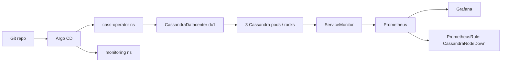

# Cassandra on Kubernetes: GitOps Lab

Local GitOps lab: a 3-node Apache Cassandra datacenter on [k3d](https://k3d.io), managed by [cass-operator](https://github.com/k8ssandra/cass-operator) and [Argo CD](https://argo-cd.readthedocs.io/), with Prometheus/Grafana for scrape, alert, and dashboard.

This is a **laptop-sized lab**, not a production cluster. It is meant to show GitOps for a stateful workload, operator lifecycle, and the gaps between “Synced in Argo CD” and “actually healthy.”

**Repo:** [github.com/sdh202/cassandra-k8s-gitops](https://github.com/sdh202/cassandra-k8s-gitops)

## Architecture



| Layer | What runs |
| --- | --- |
| Cluster | k3d `cassandra-platform` — 1 server, 3 agents |
| TLS / webhook certs | cert-manager v1.21.2 |
| Cassandra operator | cass-operator Helm 0.67.2 (app 1.32.0) |
| GitOps | Argo CD (installed with server-side apply) |
| Workload | Cassandra 4.1.5, cluster `lab-cluster`, datacenter `dc1`, 3 racks |
| Observability | kube-prometheus-stack 65.8.1 |

Git is the source of truth for Cassandra (`cassandra/`) and for the two Argo CD Applications (`argocd-apps/`). The monitoring chart comes from the Prometheus community Helm repo; values live in this repo as `monitoring-values.yaml`.

## Repo layout

```
argocd-apps/           # Argo CD Applications (applied once)
  cassandra-app.yaml   # syncs path cassandra/ from this repo
  monitoring-app.yaml  # Helm: kube-prometheus-stack + this repo's values
cassandra/
  dc1.yaml             # CassandraDatacenter CR
  service-monitor.yaml # Prometheus scrape of /metrics
  alert-rules.yaml     # CassandraNodeDown
  grafana-dashboard.json
monitoring-values.yaml # Helm values for the monitoring stack
scripts/create-cluster.sh
docs/incidents.md      # failures hit while building this
```

## Bootstrap

Prereqs: Docker, k3d, kubectl, Helm.

```bash
# 1. Cluster
./scripts/create-cluster.sh

# 2. cert-manager
kubectl apply -f https://github.com/cert-manager/cert-manager/releases/download/v1.21.2/cert-manager.yaml
kubectl -n cert-manager rollout status deployment/cert-manager-webhook

# 3. cass-operator
helm repo add k8ssandra https://helm.k8ssandra.io/stable
helm repo update
helm upgrade --install cass-operator k8ssandra/cass-operator \
  --namespace cass-operator --create-namespace \
  --version 0.67.2

# 4. Argo CD (CRDs exceed the 256Ki annotation limit without server-side apply)
kubectl create namespace argocd
kubectl apply -n argocd --server-side --force-conflicts \
  -f https://raw.githubusercontent.com/argoproj/argo-cd/stable/manifests/install.yaml

# 5. Applications — Argo CD then reconciles Cassandra + monitoring
kubectl apply -f argocd-apps/cassandra-app.yaml
kubectl apply -f argocd-apps/monitoring-app.yaml
```

Both Applications use automated sync with prune and self-heal.

## Verify

```bash
# Cassandra: 3 Ready pods, one per rack
kubectl get pods -n cass-operator -l cassandra.datastax.com/cluster=lab-cluster
kubectl get cassandradatacenter -n cass-operator

# Optional: nodetool from a pod
kubectl exec -n cass-operator lab-cluster-dc1-r1-sts-0 -c cassandra -- nodetool status

# Argo CD
kubectl get applications -n argocd

# Prometheus + Grafana
kubectl get pods -n monitoring
kubectl -n monitoring port-forward svc/monitoring-stack-grafana 3000:80
```

Grafana: `http://localhost:3000` — user `admin`, password `admin` (lab only). Import `cassandra/grafana-dashboard.json` (dashboard title: **Cassandra Cluster - DC1 Overview**).

## What GitOps owns vs what it does not

**In git / Argo CD**

- `CassandraDatacenter` size, racks, storage, JVM heap
- ServiceMonitor and PrometheusRule
- kube-prometheus-stack Helm values (retention, resources, selectors)

**Installed once, not reconciled from this repo**

- k3d cluster, cert-manager, cass-operator Helm release, Argo CD itself

That split is intentional for a lab. Production would usually Terraform or Crossplane the bootstrap too.

## Incidents

Three things broke during bring-up. They are the useful part of this repo:

1. Argo CD CRDs hit Kubernetes’ **256Ki annotation limit** → server-side apply.
2. kube-prometheus-stack CRDs, same limit → `ServerSideApply=true` and `Replace=true` on the Application.
3. Prometheus pods never appeared while Argo CD said **Synced/Healthy** → Prometheus operator reconcile was stuck; restarting the operator pod unblocked it.

Details: [docs/incidents.md](docs/incidents.md).

## Scope and non-goals

- No backups, multi-DC, or authentication beyond the operator’s insecure management API.
- Alertmanager and node-exporter are off to keep the k3d node from paging itself to death.
- Grafana dashboard JSON is in git; it is not auto-provisioned as a ConfigMap.
- Helm values in git are lab defaults (short retention, small memory). Do not copy the Grafana password into anything real.
